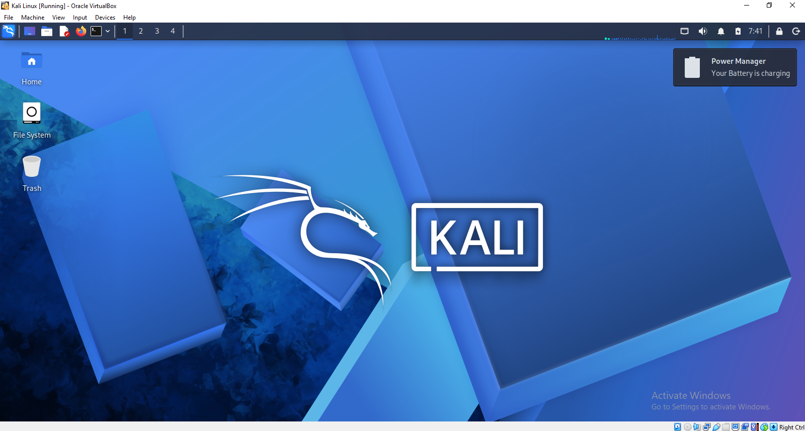
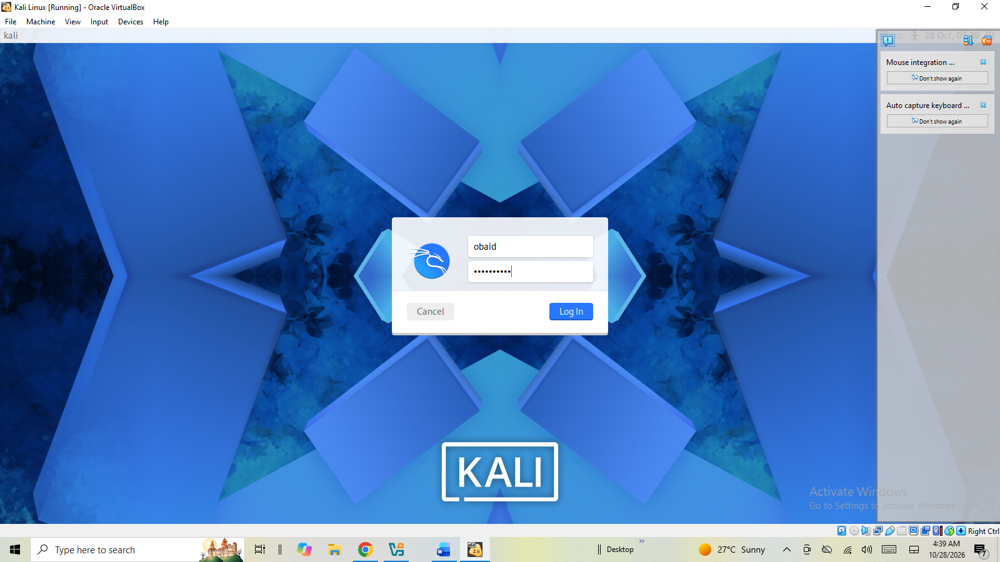
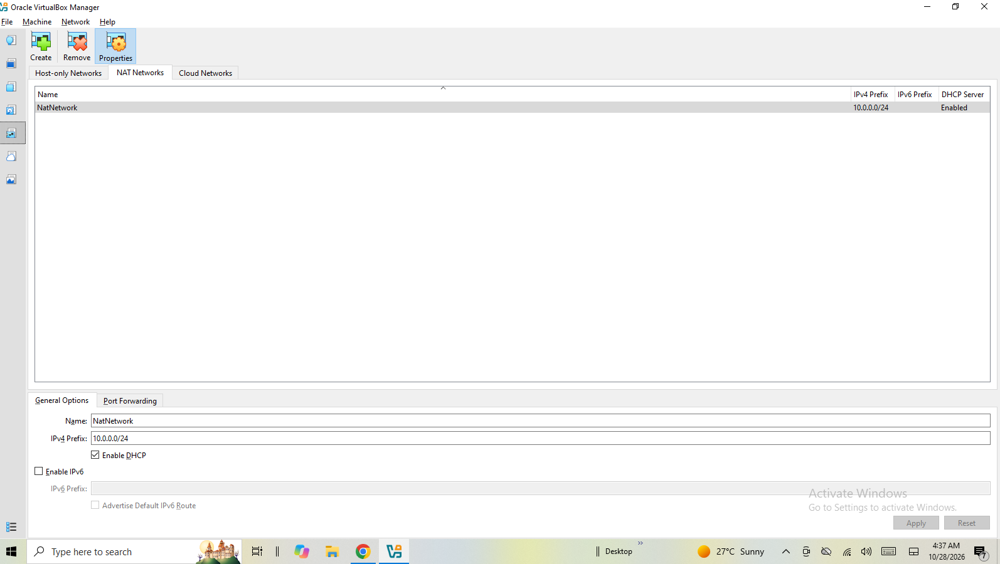

# 🐧 Linux Network Configuration Lab

### Week 01 — Network Walks IT Trainers Internship


> **Project Overview:** Setting up Kali Linux in VirtualBox, configuring a manual IPv4 address, enabling NAT networking, and checking internet connectivity.

---

## 📌 1. Overview

This lab was completed as part of my first-week task during the **Network Walks IT Trainers remote internship**.

The objective was to set up Kali Linux in Oracle VirtualBox, configure a manual IP address within the `10.0.0.0/24` subnet, configure NAT networking, and test network connectivity.

## 🎯 2. Objectives

- Install and configure Kali Linux in VirtualBox.
- Assign a manual IPv4 address.
- Configure NAT networking.
- Understand IP addressing, gateways, and DNS.
- Test internet connectivity.

## 🧰 3. Tools & Technologies

- Kali Linux
- Oracle VM VirtualBox
- IPv4 Addressing
- NAT Networking
- Linux Terminal

---

## ⚙️ 4. Step-by-Step Implementation

### Step 1 — Kali Linux Setup

Created and started the Kali Linux virtual machine.





### Step 2 — VirtualBox Network Configuration

Reviewed the virtual machine's network settings to prepare the networking environment.



### Step 3 — Manual IP Configuration

Configured the manual IPv4 address within the required subnet.


The recorded network configuration was:

| Parameter | Value |
|---|---|
| IPv4 Address | `10.0.0.2` |
| Subnet Prefix | `/24` |
| Subnet Mask | `255.255.255.0` |
| Gateway | `10.0.0.1` |
| DNS Server | `10.0.0.1` |

### Step 4 — Network Connection Verification

Reviewed the network connection details to check the assigned address and connection settings.


### Step 5 — VirtualBox Management

Reviewed the VirtualBox environment and virtual machine management settings.


### Step 6 — Shared Folder Configuration

Reviewed shared-folder settings in VirtualBox.


---

## 💻 5. Network Verification Commands

The following Linux commands can be used to inspect network settings and test connectivity.

```bash
ip addr
ip route
cat /etc/resolv.conf
ping -c 4 8.8.8.8
ping -c 4 google.com
```

- `ip addr` — Displays network interfaces and IP addresses.
- `ip route` — Displays the routing table.
- `cat /etc/resolv.conf` — Displays DNS resolver settings.
- `ping` — Tests network reachability.

> **Note:** Run these commands and document their actual output. The provided screenshots do not independently confirm successful internet access.

## 📚 6. Learning Outcomes

- Understanding IPv4 addressing and CIDR notation.
- Configuring manual IP settings in Kali Linux.
- Learning the purpose of NAT networking.
- Understanding default gateways and DNS.
- Practicing basic network troubleshooting.

## 🛡️ 7. Cybersecurity Relevance

Linux networking is a fundamental skill in cybersecurity. Understanding IP addresses, routing, DNS, and network connectivity helps prepare for future network analysis and security testing labs.

## ✅ 8. Conclusion

This lab provided practical experience with Kali Linux, VirtualBox, manual IPv4 configuration, and fundamental networking concepts.

It established a foundation for further learning in Linux administration, network troubleshooting, and cybersecurity.

---

### 👨‍💻 Internship Portfolio

**Program:** Network Walks IT Trainers — Remote Internship  
**Week:** 01  
**Task:** Linux Installation and Network Configuration
